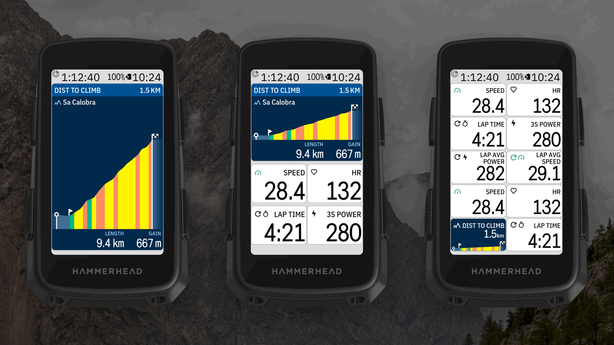
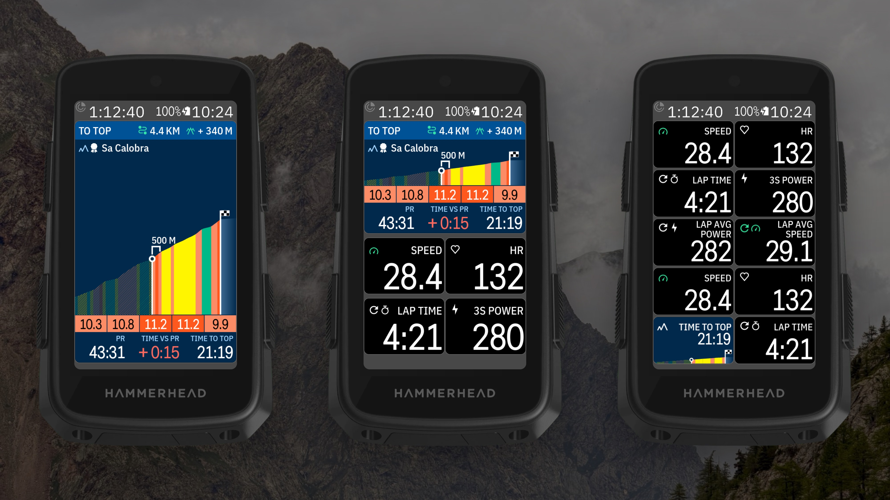
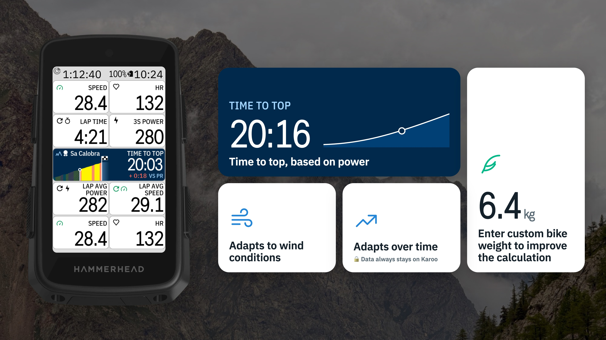

<!-- docs.sh: generated from docs/app.yml. Edit that file and run setup/docs.sh, not this block. -->
<a href="https://buymeacoffee.com/Dubadai"></a>

# Mountaineer for Karoo 3

Listed on the Karoo as **DDB Mountaineer**, next to the other DDB apps.

A climb field for the Hammerhead Karoo 3: where you are on the climb, drawn like the Karoo's own
climb graph (its grade colours, the climbed part hatched), with the time and distance to the top
and the time to your Strava PR. On the Karoo the app is **DDB Mountaineer** and the field
**Mountaineer**.





- **One tile:** time to top, distance to top or time vs PR, over a small climb graph.
- **Two tiles:** the graph with the climb's name (or its number, 3 of 30), and time to top,
  distance to top, time to PR, or both (time to top with VS PR under it).
- **Half screen and up:** TO TOP with the distance and height still to climb, the climb with
  the next 500 m as grade boxes on the biggest size, then PR, TIME VS PR and TIME TO TOP.
- **Before a climb:** DIST TO CLIMB, and the road from you to the climb's top; from 1 km before
  it, a close-up at least 2 km wide, so a short climb looks short. Every graph ends at the
  summit with a checkered flag and a bit of the road after it.
- **At the top:** SUMMIT with your time on the climb, your gap to the PR (or average power) and VAM.
- **Off route:** the Karoo's way back to the route in red, with its ups and downs.
- **No climb to show:** after the last climb, or on a route without climbs, the whole route
  and DIST TO FINISH. No route loaded: No Route.

## Install on your Karoo

1. On your phone, open the [latest release](https://github.com/Dubadai/karoo-mountaineer/releases/latest)
   and share the `mountaineer.apk` link to the **Hammerhead Companion** app (or with a computer:
   `adb install mountaineer.apk`).
2. In a ride profile, add **DDB Mountaineer → Mountaineer** to a page: one tile, two tiles or
   half a page and up.
3. Open **DDB Mountaineer** from the app list to choose what one tile and two tiles show and which
   lines the half screen shows. The Example at the top shows the field as you set it. Under
   **Time to top**, set your bike weight (one for all, or per ride profile), the wind, and
   **Improve over time**.
4. Load a route with climbs before the ride. For PR times, turn on Strava Live Segments on the
   Karoo (Settings › Strava).

New versions show up on the Karoo as an update card; tap it, then UPDATE.

<!-- /docs.sh -->

## Where the data comes from

- **Climbs:** the route you load on the Karoo (the same climbs ClimbER shows). No route, no climbs.
- **Where you are:** the Karoo's own climb fields (distance from the bottom), else distance along the route.
- **Time to top:** your 30 s power (or, without a power meter, the power your speed means on this
  grade), ridden over each 100 m still to come on its own gradient, with your weight from the Karoo
  rider profile plus your bike's (Settings; 8 kg standard, or one per ride profile).
  - **Wind:** the head- or tailwind on each 100 m, from the route's direction there and the
    [Open-Meteo](https://open-meteo.com) forecast for the climb (no account, needs a data
    connection; without one, no wind).
  - **Learns on the climb:** with a power meter, it compares the speed you actually ride with the
    speed the physics expects at your power, and corrects the time to top over about a minute.
  - **Improve over time** (Settings, off by default): carries what each climb taught into the
    next, per ride profile, and keeps a log of your climbs. The data stays on your Karoo and never
    leaves it.
- **PR and time vs PR:** the Karoo's Strava Live Segments (Karoo Settings › Strava), so no Strava
  sign-in in the app. Shows "--" off a segment.

## Try it at the desk

Load a route with climbs on the Karoo and let a GPS simulator (we use our own trainer and GPX
player) move the Karoo's GPS along it: Mountaineer only ever shows the route the Karoo navigates (no
made-up climbs, also not in debug builds).

## Build it yourself

```bash
export JAVA_HOME="/Applications/Android Studio.app/Contents/jbr/Contents/Home"
./gradlew -q assembleDebug
adb install -r app/build.nosync/outputs/apk/debug/app-debug.apk
```

Then add **Mountaineer** to a ride page (Profiles › page › DDB Mountaineer › Mountaineer) at one
tile, two tiles or half a page. Settings: **DDB Mountaineer** in the app list.

Design: `docs/design/tiny-climb/` (every design round), field pictures from the real code in
`docs/design/gallery/`.

## Licence

MIT, see `LICENSE`. The included Karoo SDK in `karoo-ext/` is Apache 2.0, see `karoo-ext/LICENSE`.
